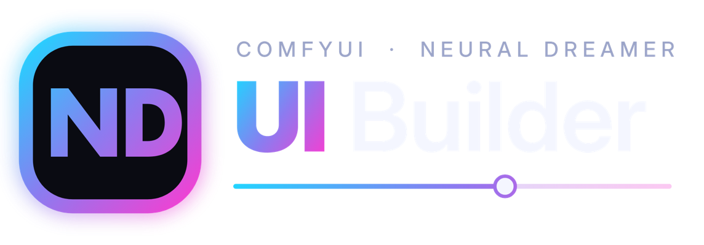
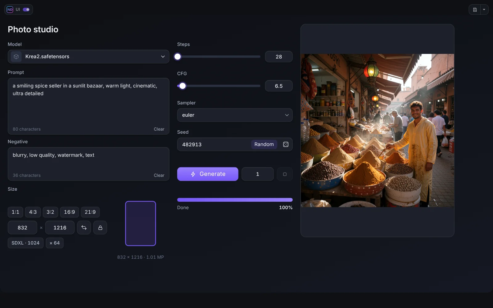
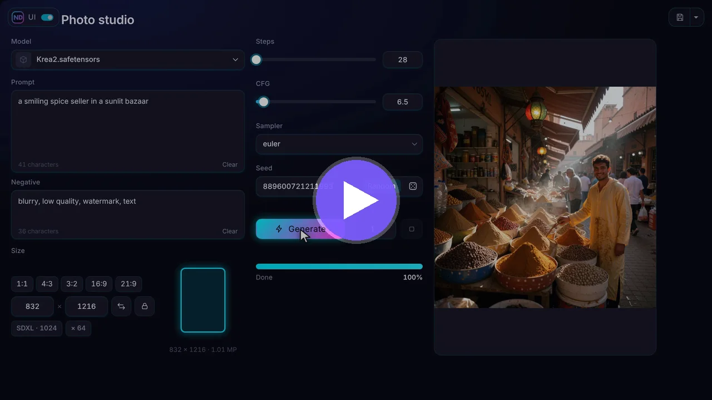
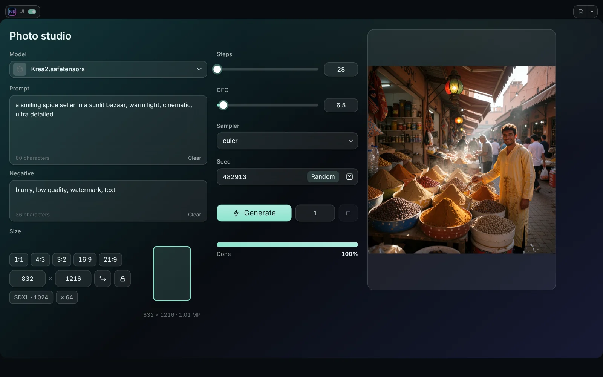

<p align="center"></p>

<p align="center">
<b>English</b> · <a href="README_RU.md">Русский</a> · <a href="README_ZH.md">中文</a>
</p>

<p align="center">
 <a href="LICENSE"></a>
</p>

# ComfyUI ND UI Builder

Build your own clean control panel for any ComfyUI workflow. Bind big, friendly widgets (a prompt box, a seed, a size picker, a Generate button, a live result window) to the parameters of the nodes, arrange them freely, and run the whole workflow from a full-window interface. The graph stays untouched underneath.



## Video

<p align="center"><a href="https://youtu.be/c8wx4VMnxcE"></a></p>

<p align="center"><b><a href="https://youtu.be/c8wx4VMnxcE">Watch the promo</a></b> (about a minute: what it is and what it does)</p>

Step-by-step tutorials, one playlist: [ComfyUI ND UI Builder on YouTube](https://www.youtube.com/playlist?list=PLGnUD4GeMWjo)

| # | Tutorial | What you learn |
|---|---|---|
| 1 | The basics | Installation, the ND UI and Edit buttons, tagging nodes |
| 2 | Your first interface | Build a complete text-to-image panel with a live result |
| 3 | Finishing touches | Tabs, spoilers, groups, themes |

The tutorials have **English, Russian and Chinese** audio tracks, the promo has English and Russian. On YouTube open **Settings (gear) → Audio track** to switch the language.

## Features

- **Visual editor.** Drag widgets onto pages, resize, group, align, layer. Undo and redo, templates, projects.
- **38 widgets** in four groups: inputs (number, slider, seed, prompt, dropdown, image / video / audio input, LoRA stack, node embed), run (Generate, Run to node, progress, queue, resolution, model picker), results (viewer with live frames and A / B compare, video and audio players, text, variants) and layout (panels, tabs, spoilers, text, images).
- **Ten themes**, with Glass and Frost blur, your own colours, gradients and backgrounds. The editor itself can be recoloured.
- **Live preview** while the sampler works, also for video with sound (ND UI Live Bridge).
- **ND UI mode.** A full-window mode with a top panel, progress bar, memory buttons, buttons taken from the ComfyUI top bar, a workflow switcher (Alt+Q) and project files.
- **Works with any nodes.** Bind to parameters of stock and third-party nodes, or embed the interface of a node itself.
- **English, Russian and Chinese** interface.



## Install

- **Comfy Registry / ComfyUI-Manager:** search for **ComfyUI ND UI Builder**.
- **Manually:** put the folder into `ComfyUI/custom_nodes/`:
  ```
  cd ComfyUI/custom_nodes
  git clone https://github.com/neural-dreamer/ComfyUI-ND-UI-Builder
  ```

Restart ComfyUI and reload the page (Ctrl+F5). Two buttons, **ND UI** and **Edit**, appear next to **Run**. No Python dependencies. Tried on the ComfyUI frontend 1.55 and 1.57.

Some widgets (Images Input, Video / Audio Input, LoRA Stack, Show Any As Text, Variant Preview) use the nodes of the companion pack [Neural Dreamer Nodes](https://github.com/neural-dreamer/ComfyUI-NeuralDreamer-Nodes), version 1.3.1 or newer (1.4.0 for the time settings of the H3 Temporal LoRA stack). The Builder works without it.

## Quick start

1. Add a short tag in square brackets to the title of the nodes you want to control: `Prompt [prompt]`, `Sampler [sampler]`.
2. Press **Edit** next to Run.
3. Add widgets from the library and bind them to the parameters of your nodes.
4. **Save**, then press **ND UI** to use the panel. **Esc** goes back to the graph.

The full walk-through is in [Quick start](docs/en/01-quick-start.md).

## Documentation

| | |
|---|---|
| [Quick start](docs/en/01-quick-start.md) | [Themes and design](docs/en/07-themes-and-design.md) |
| [The editor](docs/en/02-editor.md) | [Live preview](docs/en/08-live-preview.md) |
| [Sources and binding](docs/en/03-sources-and-binding.md) | [Media and LoRAs](docs/en/09-media-and-loras.md) |
| [Widgets](docs/en/04-widgets.md) | [Node Embed](docs/en/10-node-embed.md) |
| [Layout](docs/en/05-layout.md) | [Projects and templates](docs/en/11-projects-templates.md) |
| [The ND UI mode](docs/en/06-ui-mode.md) | [Neural Dreamer Nodes](docs/en/12-neural-dreamer-nodes.md) · [FAQ](docs/en/13-faq.md) |

## License

ComfyUI ND UI Builder is free and open source software under the [GNU Affero General Public License v3.0](LICENSE) (AGPL-3.0-only). You can use, study, change and share it, including commercially, under the terms of that license. Panels and workflows you build with it are your own work: share or sell them as you like. If you offer the Builder, or a modified version of it, to other people over a network, the AGPL requires you to make the source of that version available to them.

Copyright (c) 2026 Ivan Ovchinnikov (Neural Dreamer). One file (`js/ndui/textedit.js`) is code of the ComfyUI frontend under the GPL-3.0; see [THIRD_PARTY_NOTICES.md](THIRD_PARTY_NOTICES.md) for it, the bundled font and the runtime dependencies. Contributions: [CONTRIBUTING.md](CONTRIBUTING.md). License questions: ivan.kvento@gmail.com.

## Links

[YouTube](https://www.youtube.com/@neural_dreamer) · [Patreon](https://www.patreon.com/cw/neural_dreamer) · [Boosty](https://boosty.to/neural_dreamer) · [Neural Dreamer Nodes](https://github.com/neural-dreamer/ComfyUI-NeuralDreamer-Nodes) · [Issues](https://github.com/neural-dreamer/ComfyUI-NeuralDreamer-UI-Builder/issues)
