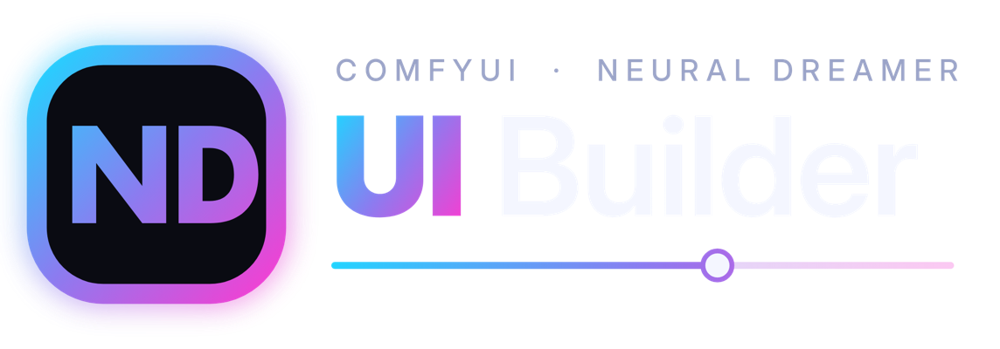
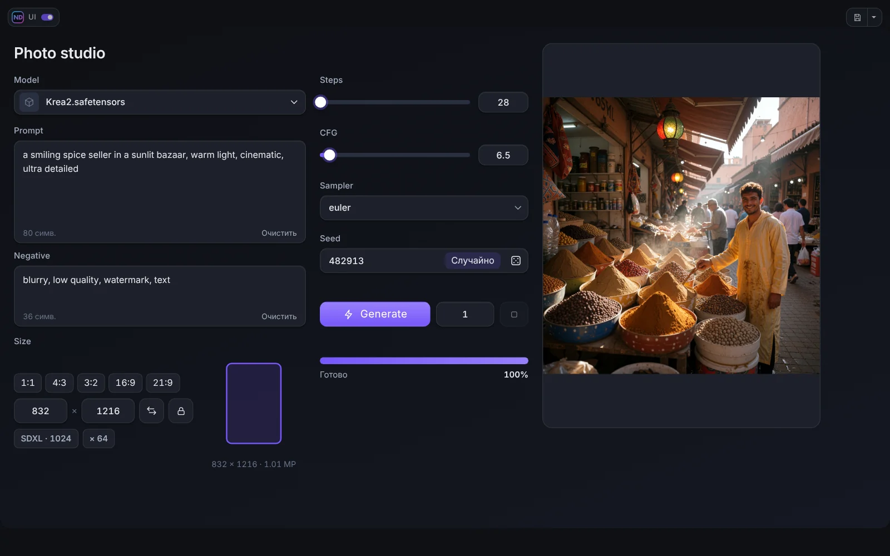
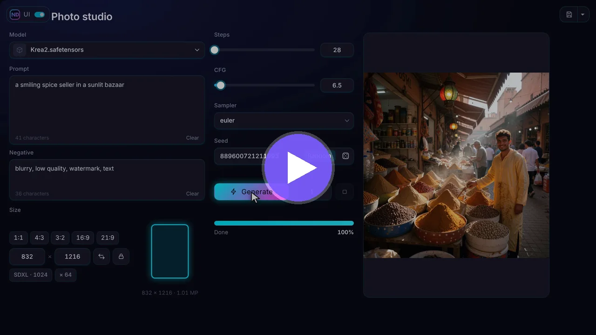
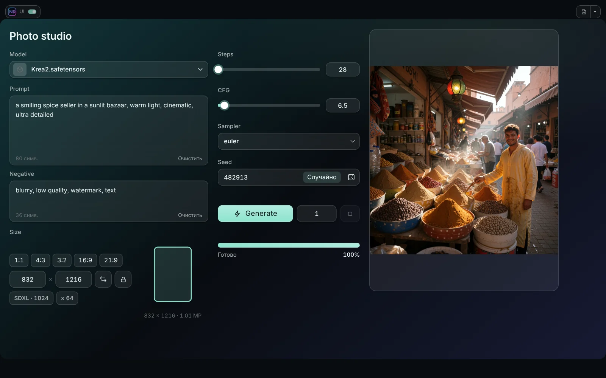

<p align="center"></p>

<p align="center">
<a href="README.md">English</a> · <b>Русский</b> · <a href="README_ZH.md">中文</a>
</p>

<p align="center">
 <a href="LICENSE"></a>
</p>

# ComfyUI ND UI Builder

Соберите собственную аккуратную панель управления для любого воркфлоу ComfyUI. Привяжите крупные удобные виджеты (поле промпта, seed, выбор размера, кнопку Generate, окно живого результата) к параметрам нод, расположите их как угодно и запускайте весь воркфлоу из интерфейса на весь экран. Граф под ним остаётся нетронутым.



## Видео

<p align="center"><a href="https://youtu.be/c8wx4VMnxcE"></a></p>

<p align="center"><b><a href="https://youtu.be/c8wx4VMnxcE">Смотреть промо</a></b> (около минуты: что это и что умеет)</p>

Пошаговые уроки собраны в одном плейлисте: [ComfyUI ND UI Builder на YouTube](https://www.youtube.com/playlist?list=PLGnUD4GeMWjo)

| № | Урок | Чему вы научитесь |
|---|---|---|
| 1 | Основы | Установка, кнопки ND UI и Edit, теги нод |
| 2 | Первый интерфейс | Собрать полную панель text-to-image с живым результатом |
| 3 | Финальные штрихи | Вкладки, спойлеры, группы, темы |

У уроков есть звуковые дорожки на **английском, русском и китайском**, у промо — на английском и русском. На YouTube переключайте язык: **Настройки (шестерёнка) → Звуковая дорожка**.

## Возможности

- **Визуальный редактор.** Перетаскивайте виджеты на страницы, меняйте размер, группируйте, выравнивайте, управляйте слоями. Отмена и возврат, шаблоны, проекты.
- **38 виджетов** в четырёх группах: ввод (число, ползунок, seed, промпт, список, ввод картинок / видео / аудио, стек LoRA, встроенная нода), запуск (Generate, выполнить до ноды, прогресс, очередь, разрешение, выбор модели), результаты (просмотр с живыми кадрами и сравнением A / B, видео- и аудиоплееры, текст, варианты) и оформление (панели, вкладки, спойлеры, текст, картинки).
- **Десять тем**, размытие в Стекле и Инее, свои цвета, градиенты и фоны. Сам редактор тоже можно перекрасить.
- **Живое превью** во время работы сэмплера, в том числе видео со звуком (ND UI Live Bridge).
- **Режим ND UI.** Режим на весь экран с верхней панелью, полосой прогресса, кнопками памяти, кнопками с верхней панели ComfyUI, переключателем воркфлоу (Alt+Q) и файлами проектов.
- **Работает с любыми нодами.** Привязка к параметрам обычных и сторонних нод или встраивание интерфейса самой ноды.
- Интерфейс на **английском, русском и китайском**.



## Установка

- **Comfy Registry / ComfyUI-Manager:** найдите **ComfyUI ND UI Builder**.
- **Вручную:** положите папку в `ComfyUI/custom_nodes/`:
  ```
  cd ComfyUI/custom_nodes
  git clone https://github.com/neural-dreamer/ComfyUI-NeuralDreamer-UI-Builder
  ```

Перезапустите ComfyUI и обновите страницу (Ctrl+F5). Рядом с **Run** появятся две кнопки, **ND UI** и **Edit**. Python-зависимостей нет. Проверено на фронтенде ComfyUI 1.55 и 1.57.

Некоторым виджетам (Images Input, ввод видео / аудио, стек LoRA, Show Any As Text, превью вариантов) нужны ноды парного пака [Neural Dreamer Nodes](https://github.com/neural-dreamer/ComfyUI-NeuralDreamer-Nodes) версии 1.3.1 или новее (для настроек времени стека LoRA H3 Temporal нужна 1.4.0). Сам Builder работает и без него.

## Быстрый старт

1. Допишите в заголовок нод, которыми хотите управлять, короткую метку в квадратных скобках: `Prompt [prompt]`, `Sampler [sampler]`.
2. Нажмите **Edit** рядом с Run.
3. Добавьте виджеты из библиотеки и привяжите их к параметрам нод.
4. **Сохраните** и нажмите **ND UI**, чтобы работать с панелью. **Esc** возвращает к графу.

Подробно: [Быстрый старт](docs/ru/01-quick-start.md).

## Документация

| | |
|---|---|
| [Быстрый старт](docs/ru/01-quick-start.md) | [Темы и оформление](docs/ru/07-themes-and-design.md) |
| [Редактор](docs/ru/02-editor.md) | [Живое превью](docs/ru/08-live-preview.md) |
| [Источники и привязка](docs/ru/03-sources-and-binding.md) | [Медиа и LoRA](docs/ru/09-media-and-loras.md) |
| [Виджеты](docs/ru/04-widgets.md) | [Встроенная нода](docs/ru/10-node-embed.md) |
| [Раскладка](docs/ru/05-layout.md) | [Проекты и шаблоны](docs/ru/11-projects-templates.md) |
| [Режим ND UI](docs/ru/06-ui-mode.md) | [Neural Dreamer Nodes](docs/ru/12-neural-dreamer-nodes.md) · [Частые вопросы](docs/ru/13-faq.md) |

## Лицензия

ComfyUI ND UI Builder — свободное программное обеспечение с открытым исходным кодом под лицензией [GNU Affero General Public License v3.0](LICENSE) (AGPL-3.0-only). Его можно использовать, изучать, изменять и распространять, в том числе в коммерческих целях, на условиях этой лицензии. Панели и воркфлоу, которые вы создаёте с его помощью, — ваша собственная работа: делитесь ими и продавайте как хотите. Если вы предоставляете Builder или его изменённую версию другим людям по сети, AGPL требует открыть им исходный код этой версии.

Copyright (c) 2026 Ivan Ovchinnikov (Neural Dreamer). Один файл (`js/ndui/textedit.js`) — код фронтенда ComfyUI под GPL-3.0; о нём, о встроенном шрифте и о зависимостях см. [THIRD_PARTY_NOTICES.md](THIRD_PARTY_NOTICES.md). Вклад в проект: [CONTRIBUTING.md](CONTRIBUTING.md). Вопросы по лицензии: ivan.kvento@gmail.com.

## Ссылки

[YouTube](https://www.youtube.com/@neural_dreamer) · [Patreon](https://www.patreon.com/cw/neural_dreamer) · [Boosty](https://boosty.to/neural_dreamer) · [Neural Dreamer Nodes](https://github.com/neural-dreamer/ComfyUI-NeuralDreamer-Nodes) · [Issues](https://github.com/neural-dreamer/ComfyUI-NeuralDreamer-UI-Builder/issues)
