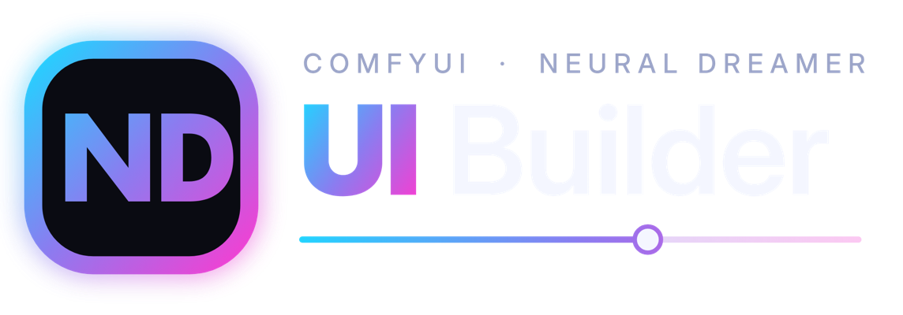
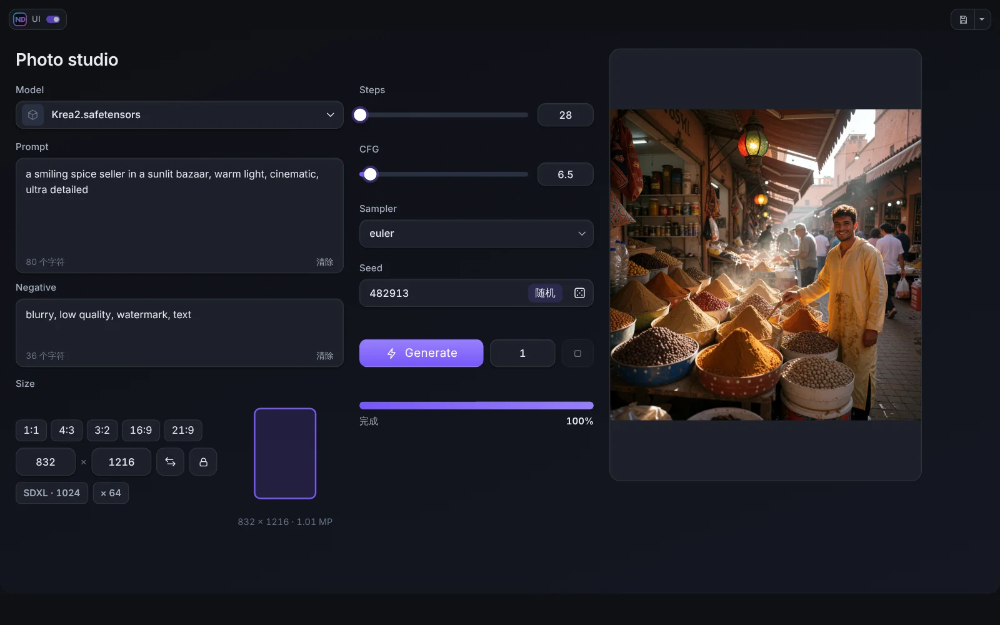
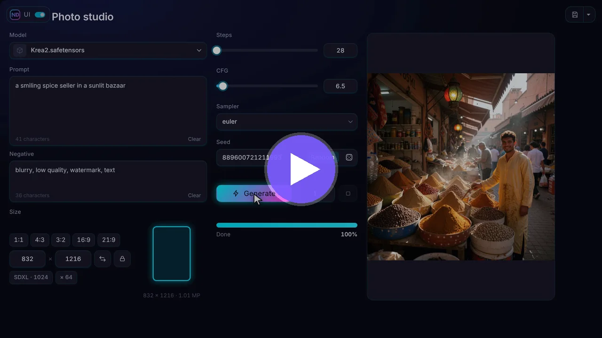
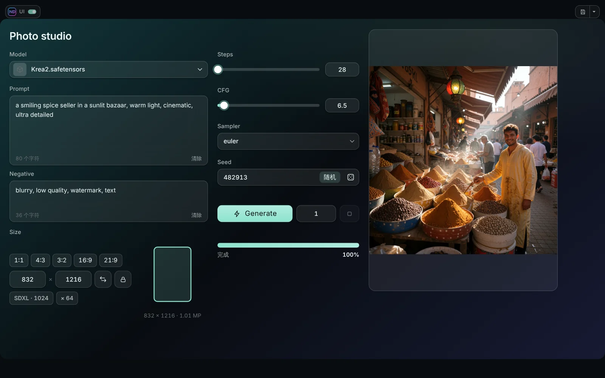

<p align="center"></p>

<p align="center">
<a href="README.md">English</a> · <a href="README_RU.md">Русский</a> · <b>中文</b>
</p>

<p align="center">
 <a href="LICENSE"></a>
</p>

# ComfyUI ND UI Builder

为任何 ComfyUI 工作流打造你自己的简洁控制面板。把大而友好的控件（提示词框、种子、尺寸选择、Generate 按钮、实时结果窗口）绑定到节点参数上，自由排布，然后在全屏界面中运行整个工作流。下面的节点图保持不变。



## 视频

<p align="center"><a href="https://youtu.be/c8wx4VMnxcE"></a></p>

<p align="center"><b><a href="https://youtu.be/c8wx4VMnxcE">观看宣传片</a></b>（约一分钟：它是什么、能做什么）</p>

分步教程都在同一个播放列表中：[YouTube 上的 ComfyUI ND UI Builder](https://www.youtube.com/playlist?list=PLGnUD4GeMWjo)

| # | 教程 | 你将学到 |
|---|---|---|
| 1 | 基础 | 安装、ND UI 与 Edit 按钮、给节点打标签 |
| 2 | 你的第一个界面 | 搭建带实时结果的完整文生图面板 |
| 3 | 收尾润色 | 标签页、折叠面板、分组、主题 |

教程提供**英语、俄语和中文**音轨，宣传片提供英语和俄语音轨。在 YouTube 上打开**设置（齿轮）→ 音轨**即可切换语言。

## 功能

- **可视化编辑器。** 把控件拖到页面上，调整大小、分组、对齐、管理图层。支持撤销与重做、模板和项目。
- **38 个控件**，分为四组：输入（数字、滑块、种子、提示词、下拉列表、图片 / 视频 / 音频输入、LoRA 堆栈、嵌入节点）、运行（Generate、运行到节点、进度、队列、分辨率、模型选择器）、结果（带实时画面和 A / B 对比的查看器、视频和音频播放器、文本、变体）以及布局（面板、标签页、折叠框、文本、图片）。
- **十个主题**，支持玻璃和霜的模糊效果，以及自定义颜色、渐变和背景。编辑器本身也可以换色。
- **实时预览**：采样器工作时即可看到画面，也支持带声音的视频（ND UI Live Bridge）。
- **ND UI 模式。** 全屏模式，带顶部面板、进度条、内存按钮、取自 ComfyUI 顶栏的按钮、工作流切换器（Alt+Q）和项目文件。
- **适用于任何节点。** 可绑定原版和第三方节点的参数，也可嵌入节点自身的界面。
- 界面支持**英语、俄语和中文**。



## 安装

- **Comfy Registry / ComfyUI-Manager：** 搜索 **ComfyUI ND UI Builder**。
- **手动安装：** 把文件夹放入 `ComfyUI/custom_nodes/`：
  ```
  cd ComfyUI/custom_nodes
  git clone https://github.com/neural-dreamer/ComfyUI-ND-UI-Builder
  ```

重启 ComfyUI 并刷新页面（Ctrl+F5）。**Run** 旁边会出现 **ND UI** 和 **Edit** 两个按钮。没有 Python 依赖。已在 ComfyUI 前端 1.55 和 1.57 上测试。

部分控件（Images Input、视频 / 音频输入、LoRA 堆栈、Show Any As Text、变体预览）使用配套插件 [Neural Dreamer Nodes](https://github.com/neural-dreamer/ComfyUI-NeuralDreamer-Nodes) 的节点，需要 1.3.1 或更高版本（H3 Temporal LoRA 堆栈的时间设置需要 1.4.0）。没有它 Builder 也能工作。

## 快速开始

1. 在要控制的节点标题后加上方括号标签：`Prompt [prompt]`、`Sampler [sampler]`。
2. 点击 Run 旁边的 **Edit**。
3. 从控件库添加控件，并绑定到节点的参数。
4. **保存**，然后点击 **ND UI** 使用面板。按 **Esc** 回到节点图。

完整步骤见 [快速开始](docs/zh/01-quick-start.md)。

## 文档

| | |
|---|---|
| [快速开始](docs/zh/01-quick-start.md) | [主题与设计](docs/zh/07-themes-and-design.md) |
| [编辑器](docs/zh/02-editor.md) | [实时预览](docs/zh/08-live-preview.md) |
| [源与绑定](docs/zh/03-sources-and-binding.md) | [媒体与 LoRA](docs/zh/09-media-and-loras.md) |
| [控件](docs/zh/04-widgets.md) | [嵌入节点](docs/zh/10-node-embed.md) |
| [布局](docs/zh/05-layout.md) | [项目与模板](docs/zh/11-projects-templates.md) |
| [ND UI 模式](docs/zh/06-ui-mode.md) | [Neural Dreamer Nodes](docs/zh/12-neural-dreamer-nodes.md) · [常见问题](docs/zh/13-faq.md) |

## 许可证

ComfyUI ND UI Builder 是自由开源软件，采用 [GNU Affero General Public License v3.0](LICENSE)（AGPL-3.0-only）发布。你可以在该许可证的条款下使用、研究、修改和分享它，包括用于商业目的。你用它制作的面板和工作流是你自己的作品，可以自由分享或出售。如果你通过网络向他人提供 Builder 或其修改版本，AGPL 要求你向这些用户提供该版本的源代码。

Copyright (c) 2026 Ivan Ovchinnikov (Neural Dreamer)。其中一个文件（`js/ndui/textedit.js`）是 ComfyUI 前端的代码，采用 GPL-3.0；关于它、内置字体和运行时依赖，见 [THIRD_PARTY_NOTICES.md](THIRD_PARTY_NOTICES.md)。贡献：[CONTRIBUTING.md](CONTRIBUTING.md)。许可证问题：ivan.kvento@gmail.com。

## 链接

[YouTube](https://www.youtube.com/@neural_dreamer) · [Patreon](https://www.patreon.com/cw/neural_dreamer) · [Boosty](https://boosty.to/neural_dreamer) · [Neural Dreamer Nodes](https://github.com/neural-dreamer/ComfyUI-NeuralDreamer-Nodes) · [Issues](https://github.com/neural-dreamer/ComfyUI-NeuralDreamer-UI-Builder/issues)
