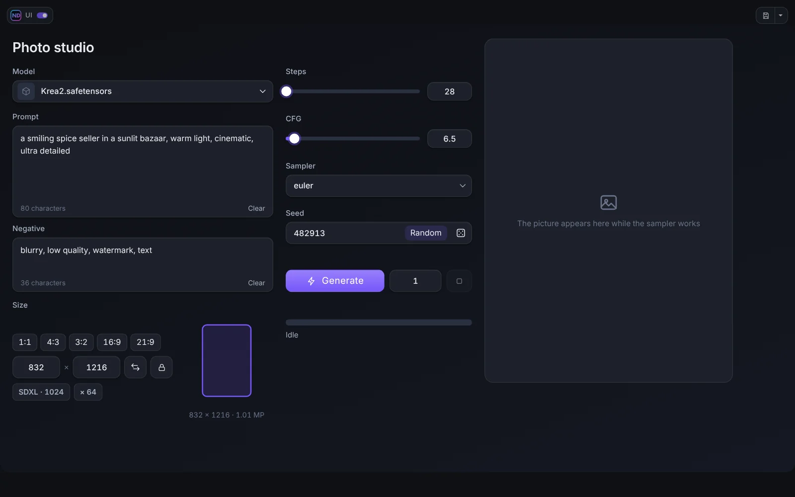
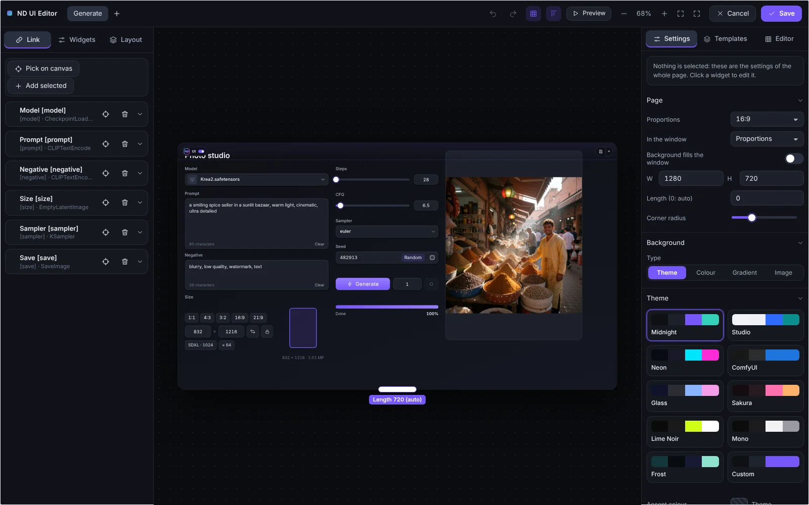

# Quick start

This page takes you from nothing to your first working panel in about five minutes.

## Install

1. Put the folder `ComfyUI-NeuralDreamer-UI-Builder` into `ComfyUI/custom_nodes/` (or install it from the Comfy Registry / ComfyUI-Manager by the name **ComfyUI ND UI Builder**).
2. Restart ComfyUI and reload the browser page with Ctrl+F5.
3. Two buttons appear in the action bar next to **Run**: **ND UI** and **Edit**.

The pack has no Python dependencies. It was tried on the ComfyUI frontend 1.55 and 1.57. A few widgets need the companion pack [Neural Dreamer Nodes](https://github.com/neural-dreamer/ComfyUI-NeuralDreamer-Nodes) (version 1.3.1 or newer), see [Neural Dreamer Nodes](12-neural-dreamer-nodes.md).

## The idea

A ComfyUI graph is powerful but crowded. ComfyUI ND UI Builder lets you build a clean **panel** for a workflow: a few big, friendly controls (a prompt box, a seed, a size picker, a Generate button, a result window) that are wired to the parameters of the nodes in the graph. You build the panel once, then work in it like in an ordinary app. The graph stays untouched underneath.

## Your first panel

1. Open or build a workflow, for example a plain text-to-image one.
2. **Mark the nodes** you want to control. Put a short tag in square brackets at the end of the node title: `Prompt [prompt]`, `Sampler [sampler]`, `Size [size]`. A tagged node becomes a **source**. (You can also add nodes from the editor without renaming them, see [Sources and binding](03-sources-and-binding.md).)
3. Press **Edit** next to Run. The editor opens.
4. In the left panel, tab **Widgets**, click a widget (or drag it to the page): for example **Prompt**. In the right panel (**Settings**), bind it to the parameter *text* of the `Prompt [prompt]` node.
5. Add **Slider**, **Seed**, **Resolution**, **Model Picker**, **Generate**, **Progress** and **Viewer** the same way.
6. Press **Preview** to try the panel inside the editor, then **Save**.
7. Press **ND UI** (or leave the editor and click the button) to enter the **ND UI mode**. Press **Generate**. Press **Esc** or the logo switch in the top corner to go back to the graph.

## Where to go next

- [The editor](02-editor.md): panels, canvas, inspector.
- [Widgets](04-widgets.md): everything the library offers.
- [Layout](05-layout.md): pages, panels, groups, tabs.
- [Themes and design](07-themes-and-design.md): make it yours.
- [Live preview](08-live-preview.md): watch the picture or the video form while it generates.
