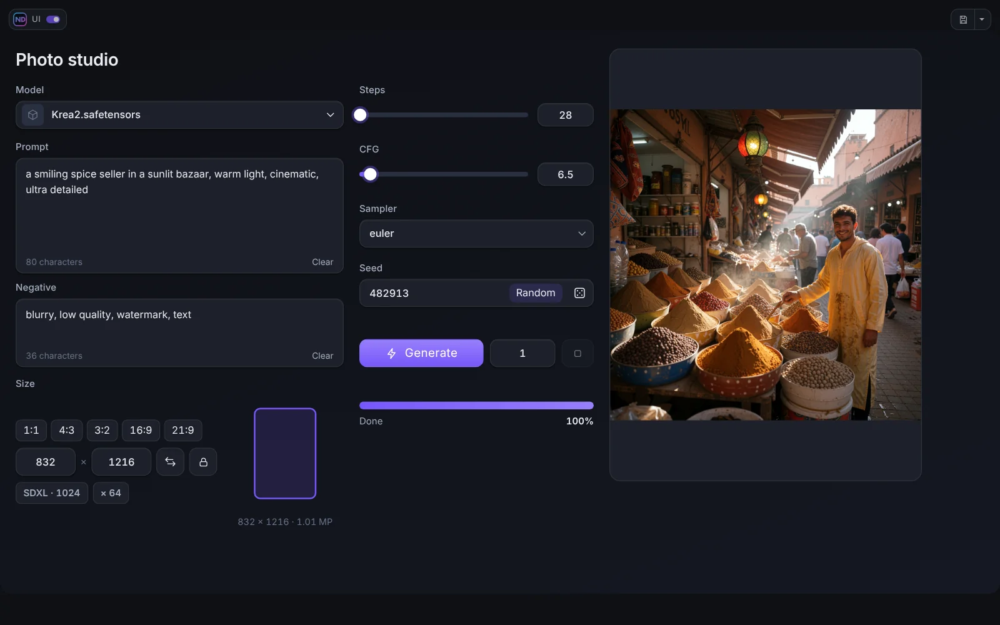

# The ND UI mode

The ND UI mode shows your panel instead of the graph. Enter it with the **ND UI** button next to Run (or the switch by the logo in the top corner) and leave it with the same switch or **Esc**.

## The top panel

At the top there is a row with the **logo and switch**, the **Project button** (save and open the panel as a file), the **page tabs** and an optional **toolbar**. Its shape, colours, opacity and blur are set in the *Top bar* section of the editor. The strip under the panel can be switched off, shown while the page scrolls, or always shown, and has its own colour.

## The toolbar of the mode

Add buttons and blocks to the toolbar in the editor, library group **Top bar**:

- **Unload models** and **Unload models and cache**: free the memory of ComfyUI with one click.
- **ComfyUI button or block**: take a button or a block from the top bar of ComfyUI itself (for example the Run button, a queue counter, or the monitor of another pack) and put it into the panel. Click **Pick from the ComfyUI top bar**, point at an element (the mouse wheel or the arrow keys switch between a button and the block around it), click to add it, **Esc** to cancel.
- **Separator**: a thin line or a gap between the buttons.

Each item has its own scale and style. Drag the items on the ghost of the panel to change the order, drag one out to remove it.

## Hotkeys

While the mode is on, the ComfyUI hotkeys are paused so that typing in a prompt cannot trigger a command by mistake. In the ComfyUI settings (**ND UI Builder → ND UI mode**) you can allow single commands: press **Add ComfyUI Hotkey**, pick the commands that should keep working. Browser shortcuts (copy, paste, select all) always work.

**Alt+Q** opens the workflow switcher (hold Alt, press Q to step through, release Alt to switch). **Ctrl+S** saves the project when the mode is on and the panel has a project file.

## Progress bar

An optional thin bar along the top or bottom edge shows the progress of the run: two bars (nodes and steps of the current node) or one, accent colour or your own gradient.

## Run, queue and progress

The **Generate** widget queues the workflow with the current values of the panel. **Queue** shows how many runs wait. **Progress** and the progress bar count the nodes that really run (cached nodes are skipped), so the bar does not jump to 90 % at the start.

## Activity and memory

The **Activity** widget shows an animated mark while ComfyUI works. The **Viewer**, **Video Player** and **Live Preview** can show the same animation while no live frame comes.

## The state of the mode in the graph

The node **ND UI Active** (category *Neural Dreamer/UI*) has the output *active* that is true while the ND UI mode is on. Use it to make a workflow behave differently when it is run from the panel.
