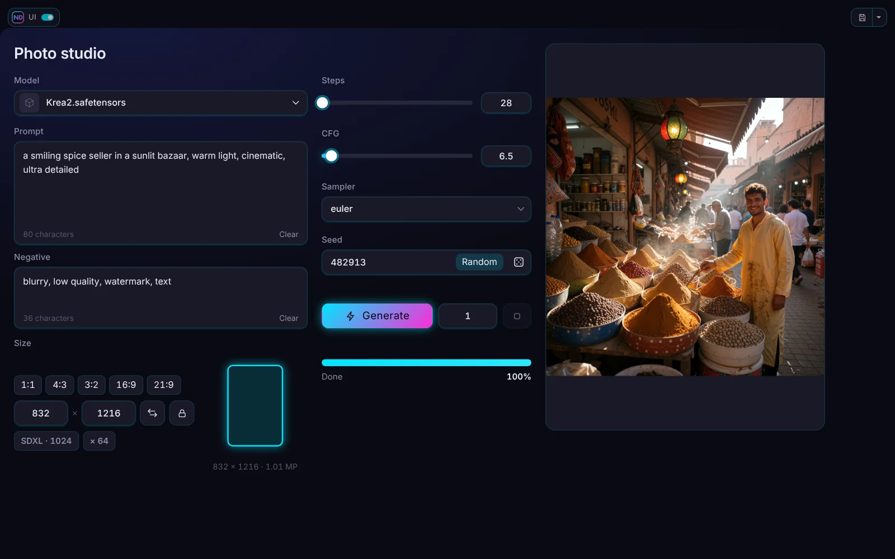
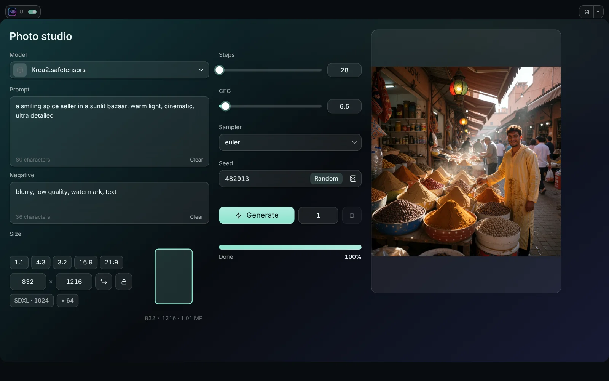
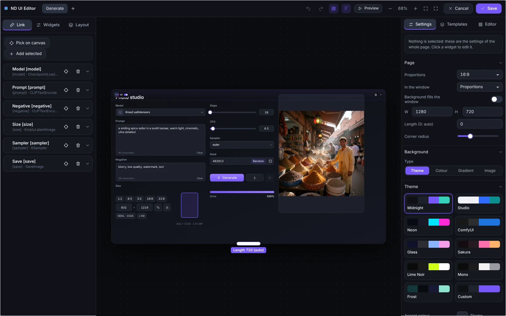

# Themes and design

## Themes

The **Theme** section of the page settings has ten themes: **Midnight**, **Studio** (light), **Neon**, **ComfyUI**, **Glass**, **Sakura**, **Lime Noir**, **Mono**, **Frost** and **Custom** (your accent and background).

- **Accent colour** replaces the accent of the theme everywhere; clear it to go back to the theme's own.
- **Frost** is frosted glass over a gradient: tint, accent, up to three gradient colours, angle, blur behind the cards and the opacity of the cards. **Gradient from the accent** builds a gradient for you.
- **Glass** and **Frost** blur what is behind the cards. **Use blur** in the *Look* block of a widget turns that off for one widget and the widgets inside it.

## Borders and shadow

**Borders of the widgets** switches the thin outline of panels, fields and lists on or off. The **shadow** of the cards has a blur (0 to 120), a strength and its own colour.

## Look of a widget

Every widget has a *Look* block: font size, colours (text, background, border), corner radius, opacity, blur and more. Empty values mean *as the theme says*. A Panel or a Tab panel passes its look to the widgets inside.

## Shape, density and scale

The *Look* of the page sets the corner shape (sharp, rounded, pill), the density of the widgets and the scale of the text.

## Background of the page

**Theme**, **Colour**, **Gradient** or **Image** (with a dim). The background may fill the whole window.

## The editor itself

The **Editor** tab in the right panel changes how the editor looks: accent colour, side panels, top bar, canvas background (colour or gradient) and the grid dots. It is kept in the browser, not in the workflow. **Back to the usual look** returns the defaults and brings the accent back to the default violet.

