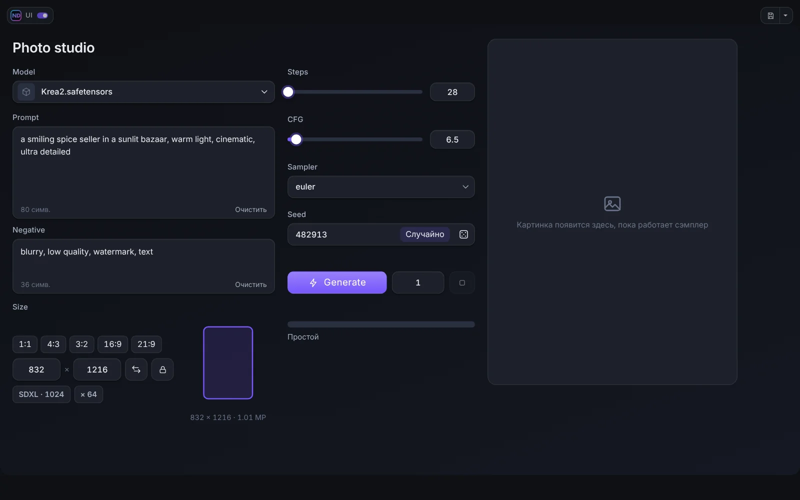
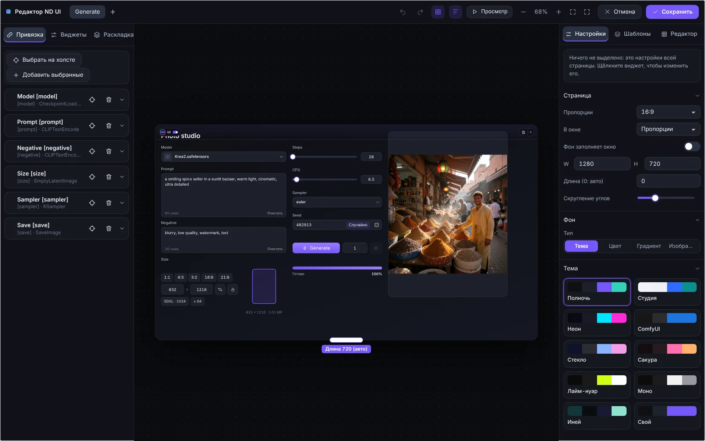

# Быстрый старт

За пять минут вы пройдёте путь от установки до первой рабочей панели.

## Установка

1. Положите папку `ComfyUI-NeuralDreamer-UI-Builder` в `ComfyUI/custom_nodes/` (или установите через Comfy Registry / ComfyUI-Manager по имени **ComfyUI ND UI Builder**).
2. Перезапустите ComfyUI и обновите страницу браузера через Ctrl+F5.
3. В панели действий рядом с **Run** появятся две кнопки: **ND UI** и **Edit**.

Python-зависимостей у пака нет. Проверено на фронтенде ComfyUI 1.55 и 1.57. Для нескольких виджетов нужен парный пак [Neural Dreamer Nodes](https://github.com/neural-dreamer/ComfyUI-NeuralDreamer-Nodes) (версия 1.3.1 или новее), см. [Neural Dreamer Nodes](12-neural-dreamer-nodes.md).

## Идея

Граф ComfyUI мощный, но перегруженный. ComfyUI ND UI Builder позволяет собрать для воркфлоу аккуратную **панель**: несколько крупных удобных элементов (поле промпта, seed, выбор размера, кнопка Generate, окно результата), привязанных к параметрам нод графа. Панель собирается один раз, дальше вы работаете в ней, как в обычном приложении. Граф под ней остаётся нетронутым.

## Первая панель

1. Откройте или соберите воркфлоу, например обычный text-to-image.
2. **Пометьте ноды**, которыми хотите управлять. Допишите в конец заголовка ноды короткую метку в квадратных скобках: `Prompt [prompt]`, `Sampler [sampler]`, `Size [size]`. Нода с меткой становится **источником**. (Можно добавлять ноды и из редактора без переименования, см. [Источники и привязка](03-sources-and-binding.md).)
3. Нажмите **Edit** рядом с Run. Откроется редактор.
4. В левой колонке, вкладка **Виджеты**, нажмите на виджет (или перетащите его на страницу), например **Промпт**. В правой колонке (**Настройки**) привяжите его к параметру *text* ноды `Prompt [prompt]`.
5. Так же добавьте **Ползунок**, **Seed**, **Разрешение**, **Выбор модели**, **Generate**, **Прогресс** и **Просмотр**.
6. Нажмите **Просмотр**, чтобы опробовать панель прямо в редакторе, затем **Сохранить**.
7. Нажмите **ND UI**, чтобы войти в **режим ND UI**. Нажмите **Generate**. Чтобы вернуться к графу, нажмите **Esc** или переключатель у логотипа в углу.

## Что дальше

- [Редактор](02-editor.md): панели, холст, инспектор.
- [Виджеты](04-widgets.md): всё, что есть в библиотеке.
- [Раскладка](05-layout.md): страницы, панели, группы, вкладки.
- [Темы и оформление](07-themes-and-design.md): сделайте под себя.
- [Живое превью](08-live-preview.md): смотрите картинку или видео прямо во время генерации.
