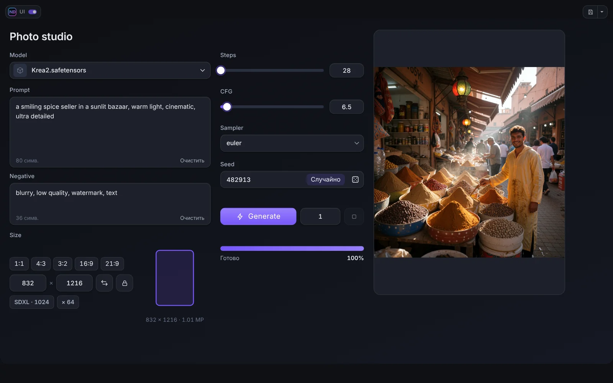

# Режим ND UI

Режим ND UI показывает вашу панель вместо графа. Войти в него можно кнопкой **ND UI** рядом с Run (или переключателем у логотипа в верхнем углу), выйти тем же переключателем или клавишей **Esc**.

## Верхняя панель

Вверху стоит ряд: **логотип с переключателем**, **кнопка Project** (сохранить и открыть панель файлом), **вкладки страниц** и необязательная **панель инструментов**. Форма, цвета, прозрачность и размытие настраиваются в разделе *Верхняя панель* редактора. Полоса под панелью может быть выключена, показываться при прокрутке страницы или всегда, и имеет свой цвет.

## Панель инструментов режима

Кнопки и блоки добавляются в редакторе, группа библиотеки **Верхняя панель**:

- **Выгрузить модели** и **Выгрузить модели и кэш**: освобождают память ComfyUI одним щелчком.
- **Кнопка или блок ComfyUI**: берёт кнопку или блок с верхней панели самого ComfyUI (например кнопку Run, счётчик очереди или монитор другого пака) и переносит в панель. Нажмите **Выбрать на панели ComfyUI**, наведите на элемент (колесо мыши или стрелки переключают между кнопкой и блоком вокруг неё), кликните, чтобы добавить, **Esc** отменяет.
- **Разделитель**: тонкая линия или промежуток между кнопками.

У каждого элемента свой масштаб и стиль. Перетаскивайте элементы по призраку панели, чтобы менять порядок, вынесите за край, чтобы удалить.

## Горячие клавиши

Пока режим включён, горячие клавиши ComfyUI приостановлены, чтобы набор текста в промпте не вызвал команду по ошибке. В настройках ComfyUI (**ND UI Builder → ND UI mode**) можно разрешить отдельные команды: нажмите **Add ComfyUI Hotkey** и выберите команды, которые должны продолжать работать. Сочетания браузера (копировать, вставить, выделить всё) работают всегда.

**Alt+Q** открывает переключатель воркфлоу (удерживайте Alt, нажимайте Q, чтобы листать, отпустите Alt, чтобы переключиться). **Ctrl+S** сохраняет проект, если режим включён и у панели есть файл проекта.

## Полоса прогресса

Необязательная тонкая полоса вдоль верхнего или нижнего края показывает прогресс запуска: две полосы (ноды и шаги текущей ноды) или одна, цвет акцента или свой градиент.

## Запуск, очередь и прогресс

Виджет **Generate** ставит воркфлоу в очередь с текущими значениями панели. **Очередь** показывает, сколько запусков ждёт. **Прогресс** и полоса прогресса считают ноды, которые действительно выполняются (кэшированные пропускаются), поэтому полоса не прыгает на 90 % в начале.

## Активность и память

Виджет **Активность** показывает анимированный значок, пока работает ComfyUI. **Просмотр**, **Видеоплеер** и **Live Preview** могут показывать ту же анимацию, пока не пришёл живой кадр.

## Состояние режима в графе

У ноды **ND UI Active** (категория *Neural Dreamer/UI*) есть выход *active*, который равен true, пока включён режим ND UI. С его помощью воркфлоу может вести себя иначе при запуске из панели.
