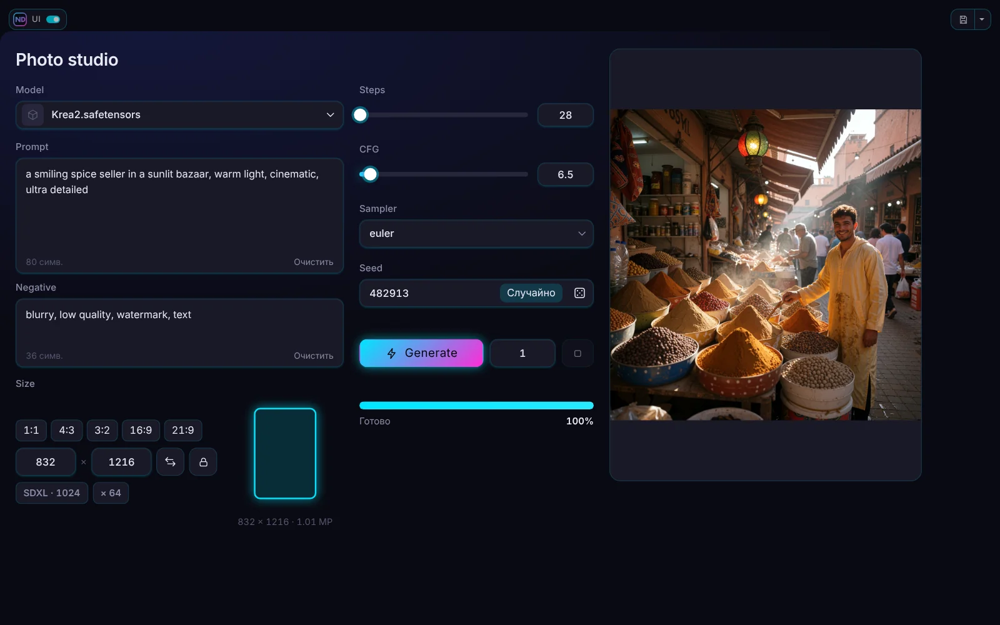
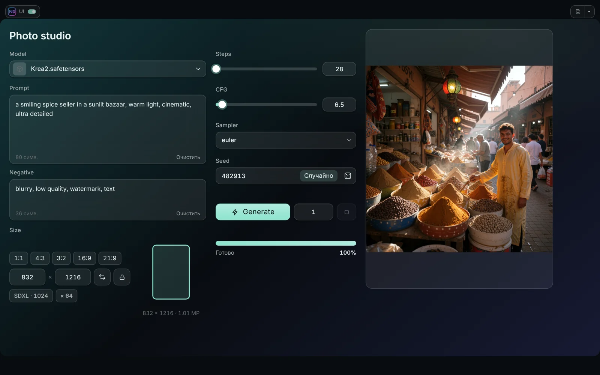
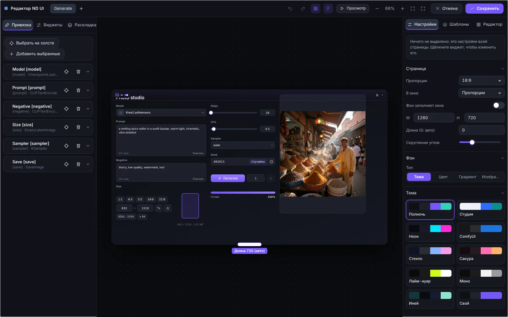

# Темы и оформление

## Темы

В разделе **Тема** настроек страницы десять тем: **Полночь**, **Студия** (светлая), **Неон**, **ComfyUI**, **Стекло**, **Сакура**, **Лайм-нуар**, **Моно**, **Иней** и **Свой** (ваш акцент и фон).

- **Цвет акцента** заменяет акцент темы везде; очистите его, чтобы вернуться к собственному цвету темы.
- **Иней** это матовое стекло по градиенту: оттенок, акцент, до трёх цветов градиента, угол, размытие за карточками и непрозрачность карточек. **Градиент от акцента** строит градиент за вас.
- **Стекло** и **Иней** размывают то, что лежит за карточками. **Использовать размытие** в блоке *Вид* виджета отключает это для одного виджета и виджетов внутри него.

## Границы и тень

**Границы виджетов** включают и выключают тонкий контур панелей, полей и списков. У **тени** карточек есть размытие (от 0 до 120), сила и свой цвет.

## Вид виджета

У каждого виджета есть блок *Вид*: размер шрифта, цвета (текст, фон, рамка), скругление, прозрачность, размытие и другое. Пустое значение означает *как в теме*. Панель и Панель с вкладками передают свой вид виджетам внутри.

## Форма, плотность и масштаб

*Вид* страницы задаёт форму углов (острые, скруглённые, «таблетка»), плотность виджетов и масштаб текста.

## Фон страницы

**Тема**, **Цвет**, **Градиент** или **Изображение** (с затемнением). Фон может заполнять всё окно.

## Сам редактор

Вкладка **Редактор** в правой колонке меняет вид редактора: цвет акцента, боковые панели, верхняя панель, фон холста (цвет или градиент) и точки сетки. Всё хранится в браузере, а не в воркфлоу. **Вернуть обычный вид** возвращает значения по умолчанию и фиолетовый акцент.

