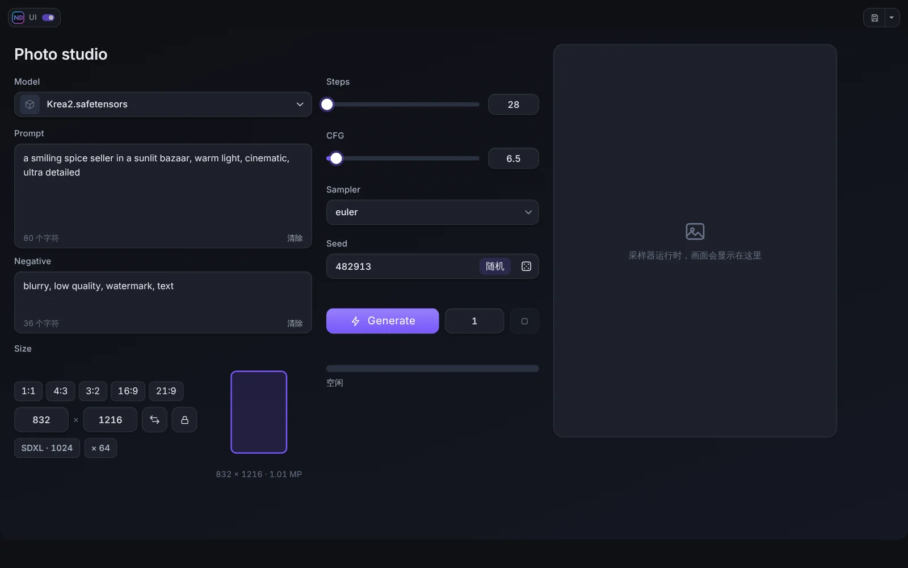
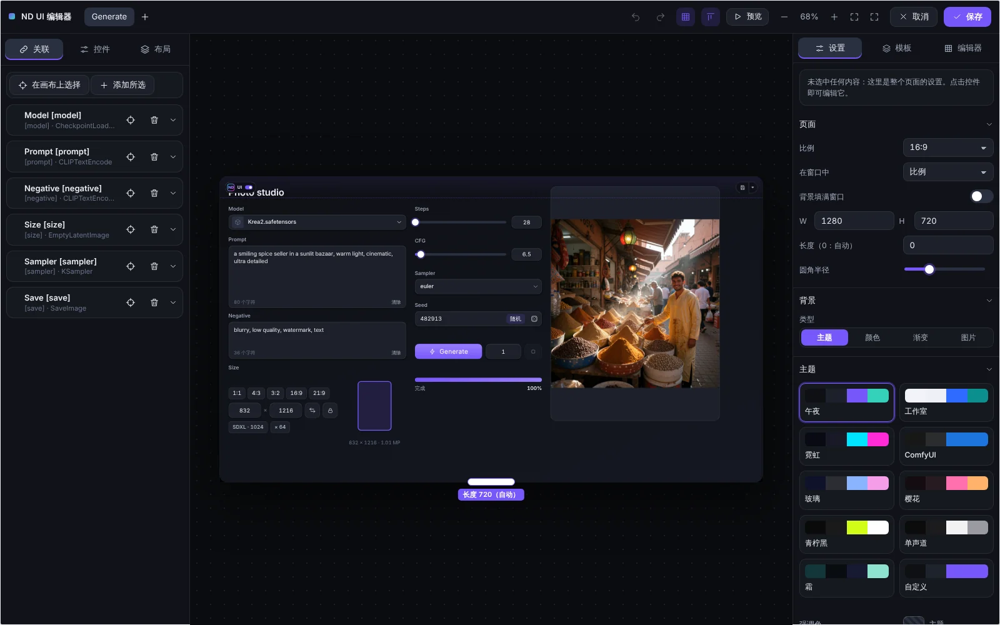

# 快速开始

本页带你在大约五分钟内从零做出第一个可用的面板。

## 安装

1. 将文件夹 `ComfyUI-ND-UI-Builder` 放入 `ComfyUI/custom_nodes/`（也可以在 Comfy Registry / ComfyUI-Manager 中按名称 **ComfyUI ND UI Builder** 安装）。
2. 重启 ComfyUI，并用 Ctrl+F5 刷新浏览器页面。
3. 操作栏中 **Run** 旁边会出现两个按钮：**ND UI** 和 **Edit**。

本插件没有 Python 依赖，已在 ComfyUI 前端 1.55 和 1.57 上测试。部分控件需要配套插件 [Neural Dreamer Nodes](https://github.com/neural-dreamer/ComfyUI-NeuralDreamer-Nodes)（1.3.1 或更高版本），见 [Neural Dreamer Nodes](12-neural-dreamer-nodes.md)。

## 思路

ComfyUI 的节点图功能强大，但很拥挤。ComfyUI ND UI Builder 让你为工作流搭建一个简洁的**面板**：几个大而友好的控件（提示词框、种子、尺寸选择、Generate 按钮、结果窗口），与节点图中节点的参数相连。面板只需搭一次，之后就像使用普通应用一样操作，下面的节点图保持不变。

## 你的第一个面板

1. 打开或搭建一个工作流，例如普通的文生图。
2. **标记节点**：在要控制的节点标题末尾加上方括号标签，例如 `Prompt [prompt]`、`Sampler [sampler]`、`Size [size]`。带标签的节点成为**源**。（也可以在编辑器中直接添加节点而不改名，见 [源与绑定](03-sources-and-binding.md)。）
3. 点击 Run 旁边的 **Edit**，编辑器打开。
4. 在左栏的**控件**标签中点击一个控件（或把它拖到页面上），例如**提示词**。在右栏（**设置**）中把它绑定到节点 `Prompt [prompt]` 的参数 *text*。
5. 用同样方式添加**滑块**、**Seed**、**分辨率**、**模型选择器**、**Generate**、**进度**和**查看器**。
6. 点击**预览**，在编辑器内试用面板，然后点击**保存**。
7. 点击 **ND UI** 进入 **ND UI 模式**，点击 **Generate**。按 **Esc** 或角落里 logo 旁的开关即可回到节点图。

## 接下来

- [编辑器](02-editor.md)：面板、画布、检查器。
- [控件](04-widgets.md)：控件库中的全部内容。
- [布局](05-layout.md)：页面、面板、分组、标签页。
- [主题与设计](07-themes-and-design.md)：按自己的喜好定制。
- [实时预览](08-live-preview.md)：生成过程中直接看到图片或视频。
