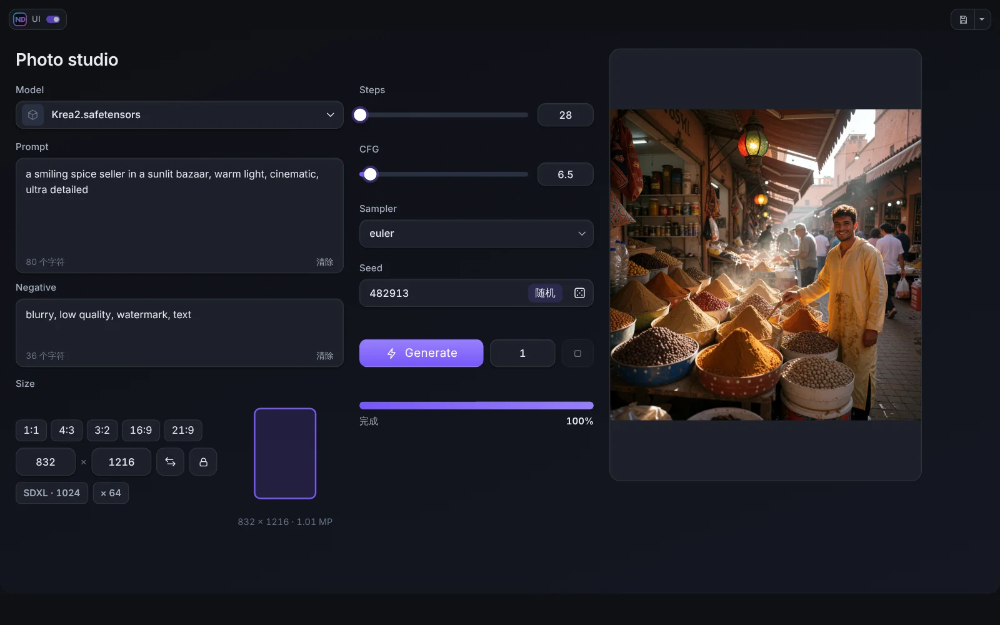

# ND UI 模式

ND UI 模式用你的面板代替节点图。点击 Run 旁的 **ND UI** 按钮（或右上角 logo 旁的开关）进入，用同一开关或 **Esc** 退出。

## 顶部面板

顶部是一行：**logo 与开关**、**Project 按钮**（把面板保存或打开为文件）、**页面标签**以及可选的**工具栏**。形状、颜色、透明度和模糊在编辑器的*顶栏*部分设置。面板下方的条带可以关闭、在页面滚动时显示或始终显示，并有自己的颜色。

## 模式工具栏

在编辑器中，从控件库的**顶栏**组添加按钮和块：

- **卸载模型**和**卸载模型和缓存**：一键释放 ComfyUI 的内存。
- **ComfyUI 按钮或块**：取 ComfyUI 自身顶栏上的按钮或块（例如 Run 按钮、队列计数器或其他插件的监视器）放入面板。点击**从 ComfyUI 顶栏选取**，指向某个元素（鼠标滚轮或方向键可在按钮和它外面的块之间切换），点击即可添加，**Esc** 取消。
- **分隔符**：按钮之间的细线或间隔。

每个项目有自己的缩放和样式。在面板的“幽灵”预览上拖动项目可调整顺序，拖出边缘即可删除。

## 快捷键

模式开启时，ComfyUI 的快捷键会暂停，避免在提示词中输入时误触发命令。在 ComfyUI 设置（**ND UI Builder → ND UI mode**）中可以放行个别命令：点击 **Add ComfyUI Hotkey**，选择需要继续生效的命令。浏览器快捷键（复制、粘贴、全选）始终可用。

**Alt+Q** 打开工作流切换器（按住 Alt，按 Q 逐个切换，松开 Alt 完成切换）。模式开启且面板有项目文件时，**Ctrl+S** 保存项目。

## 进度条

可选的细条沿上边缘或下边缘显示运行进度：两条（节点和当前节点的步数）或一条，使用强调色或自定义渐变。

## 运行、队列与进度

**Generate** 控件用面板当前的值把工作流加入队列。**队列**显示有多少次运行在等待。**进度**和进度条只统计真正运行的节点（缓存的节点会跳过），所以进度条一开始不会跳到 90%。

## 活动与内存

**活动**控件在 ComfyUI 工作时显示动画图标。**查看器**、**视频播放器**和 **Live Preview** 在没有实时画面时也可以显示同样的动画。

## 节点图中的模式状态

**ND UI Active** 节点（类别 *Neural Dreamer/UI*）有一个输出 *active*，ND UI 模式开启时为 true。可用它让工作流在从面板运行时表现不同。
