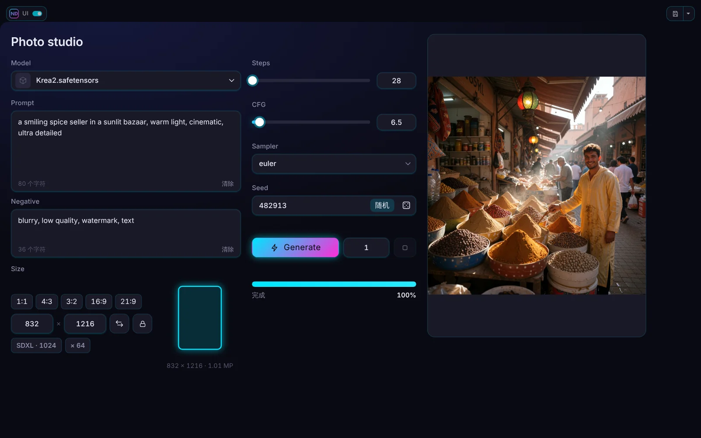
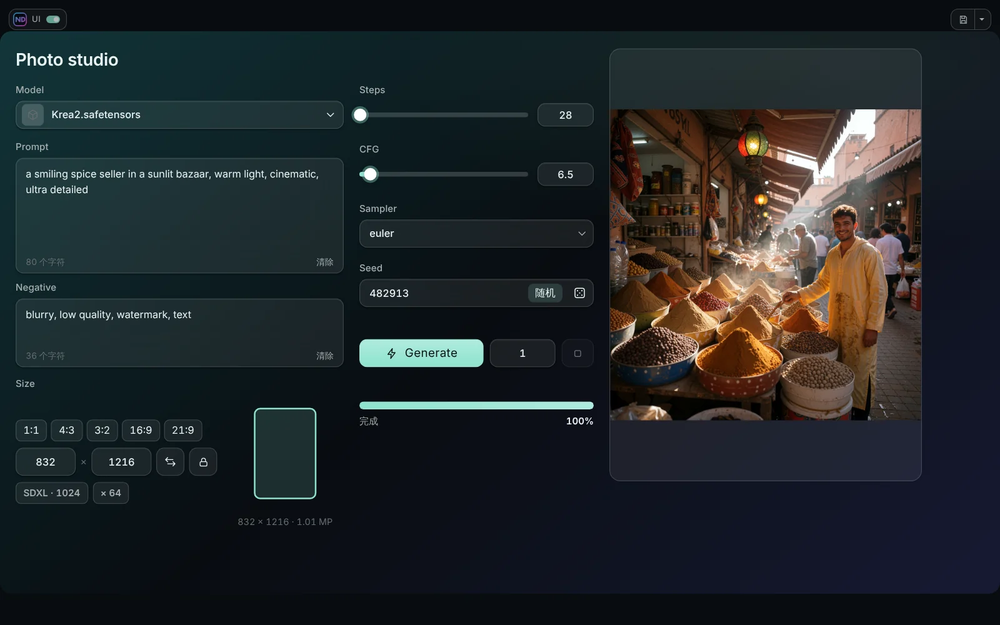
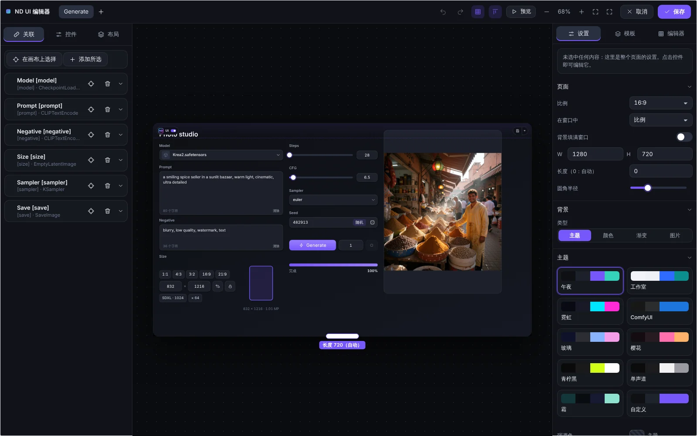

# 主题与设计

## 主题

页面设置的**主题**部分有十个主题：**午夜**、**工作室**（浅色）、**霓虹**、**ComfyUI**、**玻璃**、**樱花**、**青柠黑**、**单声道**、**霜**和**自定义**（你的强调色和背景）。

- **强调色**会在所有地方替换主题的强调色；清除它即可回到主题自己的颜色。
- **霜**是渐变之上的磨砂玻璃：色调、强调色、最多三种渐变色、角度、卡片后的模糊以及卡片不透明度。**由强调色生成渐变**会自动为你生成渐变。
- **玻璃**和**霜**会模糊卡片后面的内容。控件*外观*块中的**使用模糊**可以为单个控件及其内部的控件关闭模糊。

## 边框与阴影

**控件边框**用于开启或关闭面板、输入框和列表的细轮廓。卡片的**阴影**有模糊（0 到 120）、强度和自己的颜色。

## 控件外观

每个控件都有*外观*块：字号、颜色（文字、背景、边框）、圆角、透明度、模糊等。留空表示*跟随主题*。面板和标签页面板会把自己的外观传给内部的控件。

## 形状、密度与缩放

页面的*外观*设置角的形状（直角、圆角、胶囊）、控件密度和文字缩放。

## 页面背景

**主题**、**颜色**、**渐变**或**图片**（可调暗）。背景可以填满整个窗口。

## 编辑器本身

右栏的**编辑器**标签用来更改编辑器的外观：强调色、侧栏、顶栏、画布背景（颜色或渐变）和网格点。这些设置保存在浏览器中，而不是工作流里。**恢复默认外观**会还原默认值，并把强调色恢复为默认的紫色。

